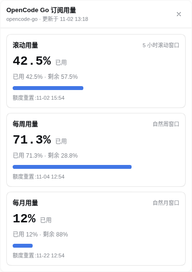
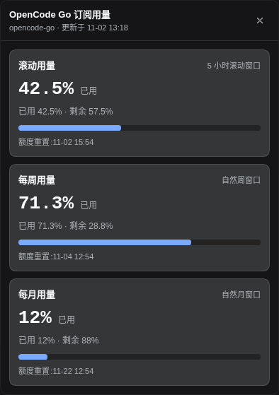

# dsh-plugin-opencode-usage

> OpenCode Go 订阅用量悬浮面板：在 DeepSeek Harness Web GUI **会话窗口左下角**显示订阅额度使用情况。


## 功能

- 在会话窗口左下角注册独立悬浮入口，不占用侧边栏入口，也不放入输入框，避免与其他插件冲突
- 点击弹出悬浮面板，展示 OpenCode Go 订阅的三个窗口：滚动用量、每周用量、每月用量
- 每张卡片显示：**已用百分比 / 剩余百分比 / 重置时间**
- 不展示具体美元金额，避免不同模型额度金额不同造成误导
- 面板以入口按钮为锚点：左边缘对齐按钮，底部在按钮上方 12px，随会话窗口/侧边栏变化自动调整
- 会话进行中自动避让贴底的输入框卡片控件（0.2.1 起）；有 `shell.bottom` 底部行时相对会话列底边定位
- 打开期间每 60s 自动刷新；支持 `Esc` 与点击面板外部关闭
- 未配置 API key 时，面板直接给出「设置 `OPENCODE_GO_API_KEY`」的可操作提示，而不是笼统的「暂时不可用」
- API key 只在 Harness host 进程内解析，不会下发浏览器
- 数据路由在 0.2.1 及以后复用 Harness 的 Host/Origin 栅栏与浏览器 cookie 鉴权，拒绝 DNS rebinding

## 截图

浅色 / 深色（DeepSeek Harness 0.2.1-rc.5）：

| 浅色 | 深色 |
| --- | --- |
|  |  |

## 工作原理

```text
DSH Web 浏览器
   │  1. 点击会话窗口左下角按钮（同源请求，自动带 Harness 登录 cookie）
   ▼
GET /plugins/opencode-usage/stats
   │
   ▼
DSH Host 插件
   │  2. Host/Origin + 登录校验（ctx.connection.requestRejection，0.2.1+）
   │  3. ctx.credentials.resolve("OPENCODE_GO_API_KEY")
   │  4. GET https://opencode.ai/zen/go/v1/usage
   │     Authorization: Bearer <api-key>
   │  5. 透出 percent / remainingPercent / resetsAt
   ▼
返回 JSON，由 React 面板渲染
```

官方接口只返回 `percent` 与 `resetsAt`：

```json
{
  "usage": {
    "rolling": { "status": "ok", "percent": 30, "resetsAt": "..." },
    "weekly":  { "status": "ok", "percent": 19, "resetsAt": "..." },
    "monthly": { "status": "ok", "percent": 9,  "resetsAt": "..." }
  }
}
```

插件直接展示官方 API 返回的百分比，不做金额换算。上游只回部分窗口时，插件只渲染返回了的窗口，不会因为少一个窗口就整体报错。

路由状态码：

| 状态码 | 含义 |
| --- | --- |
| `200` | `{ ok: true, periods: { rolling?, weekly?, monthly? } }` |
| `424` | `{ ok: false, code: "credential_not_configured" }`：没有配置 API key |
| `500` | `{ ok: false, code: "usage_query_failed" }`：上游失败（上游细节只写进 host 日志） |
| `401` / `403` | Harness 连接栅栏拒绝（未登录 / 非受信 Host） |
| `405` | 只接受 `GET` / `HEAD` |

## 目录结构

```text
dsh-plugin-opencode-usage/
├── cordis.patch.yml   # bundle patch: 把插件插入 profile host 组合
├── lib/
│   ├── index.js       # Host 半: 订阅额度 API 查询 + HTTP 路由
│   └── client.js      # Client 半: 会话窗口左下角悬浮按钮 + 面板
├── scripts/
│   └── verify-dsh.mjs # 端到端验证: 临时 profile 启动真实 dsh 并检查路由/客户端 bundle
├── tests/
│   ├── host.test.mjs  # Host 半契约单测（node:test，无依赖）
│   └── client.test.mjs# Client 半契约单测（桩 __ModuleLoader__ / React / document）
├── LICENSE
├── package.json       # dsh.bundle / dsh.client / 兼容性元数据
└── README.md
```

## 额度口径（背景说明，不用于显示）

不同模型的额度金额不同（例如 V4 Pro 月度 $15、V4 Flash 月度 $30，
整体月上限 $60），因此插件只展示官方 API 返回的百分比，不做金额换算。

| 窗口 | 官方接口字段 | 说明 |
| --- | --- | --- |
| 滚动用量 | `usage.rolling` | 5 小时滚动窗口百分比 |
| 每周用量 | `usage.weekly` | 每周窗口百分比 |
| 每月用量 | `usage.monthly` | 月度窗口百分比 |

官方 API 只返回 `percent` 与 `resetsAt`；插件同时给出 `remainingPercent = 100 - percent`。

## 安装

命令行 Web（`dsh web`）：

```sh
dsh plugin --profile web add dsh-plugin-opencode-usage
```

桌面端（DeepSeek Harness 桌面应用，profile 名 `desktop`）：

```sh
dsh plugin --profile desktop add dsh-plugin-opencode-usage
```

也可以从 GitHub 仓库安装（无构建步骤，`lib/` 即源码），或从本地目录安装：

```sh
dsh plugin --profile web add github:jiekesu967/dsh-plugin-opencode-usage
dsh plugin --profile web add /path/to/dsh-plugin-opencode-usage
```

安装后 `dsh plugin` 会自动写入该 profile 的 `dependencies`，并把
`dsh-plugin-opencode-usage` 追加到 `dsh.profile.bundles`。重启 DSH
并刷新页面后，会话窗口左下角会出现独立的“OpenCode Go 用量”悬浮入口。

> 本地开发时也可以不发布：把本仓库软链到 profile 的 `node_modules/` 下，
> 并把 `dsh-plugin-opencode-usage` 加进 `dsh.profile.bundles`。
> `npm run verify` 演示了这种做法。

## 配置

在 profile 的 `cordis.patch.yml` 覆盖 `opencode-usage` 条目：

```yaml
- id: opencode-usage
  config:
    # Harness credentials 文件中保存 API key 的变量名
    credentialRef: OPENCODE_GO_API_KEY

    # OpenCode Go 订阅接口
    apiBaseUrl: https://opencode.ai/zen/go/v1

    # host 成功结果缓存时间
    cacheMs: 30000
```

`credentialRef` 必须是合法的 POSIX shell 标识符；非法值会退回默认的
`OPENCODE_GO_API_KEY` 并在 host 日志里留一条警告，而不是静默失败。

### 凭据

在 `~/.dsh/.credentials.yaml` 中确认存在：

```yaml
OPENCODE_GO_API_KEY: sk-...
```

也可以通过 DSH Web 的 Models / Credentials 设置页写入。

> **0.2.1 起的优先级变化**：Harness 的 credentials 解析顺序在 0.2.1 这一线
> 改成了「托管文件优先，环境变量其次」（0.1.5 / 0.2.0 是环境变量优先）。
> 如果同一个变量名同时出现在 `~/.dsh/.credentials.yaml` 和进程环境里，
> 0.2.1 会使用文件里的值。插件本身不受影响，但排查「key 不生效」时值得先看一眼。

## 入口与面板定位规则

入口注册在 `shell.overlay`，绝对定位于 AppFrame 的**会话中心列左下角**：

1. 按钮：会话中心列左侧内边距 `12px`、底部 `16px`
2. 面板：左边缘与按钮对齐，底部位于按钮上方 `12px`
3. 面板宽度最大 `392px`，右侧/顶部超出视口时自动回退
4. `ResizeObserver` 监听会话中心列，侧边栏展开/收起、详情面板开关、窗口缩放时实时跟随

0.2.1 布局适配（这几条是 0.1.3 新增的）：

5. 中心列优先用 `[data-slot="main"]` 槽位出口的父节点定位，取不到才回退到旧的
   `AppFrame.children[1]`，不再依赖「第几个子节点」这种未公开顺序
6. 有 `shell.bottom` 底部行（状态栏/检查器占位）时，按钮改为相对**会话中心列底边**
   定位，不会掉进底部行里
7. 会话进行中，输入框卡片贴底且其左缘会压住入口按钮（挡住“+ / 访问模式”等控件）；
   此时按钮自动抬到输入框卡片上方，面板再叠在按钮之上。入口显示“滚动已用 x%”
   徽标后宽度变大，也会重新量一次位置

## 兼容性

插件在 `package.json` 里声明它支持哪一版 Harness。

**1. 范围声明（真正的门禁）** —— Harness 启动预检与 `dsh plugin add` 只读 `engines.dsh`：

```jsonc
"engines": {
  "node": "^22.19.0 || >=24.0.0",
  "dsh": ">=0.1.5-rc.1 <0.2.0-0 || >=0.2.0-rc.2 <0.2.1-0 || >=0.2.1-rc.1 <0.2.2-0"
},
"peerDependencies": {
  "@deepseek-ai/cordis": "^4.0.2",
  "@deepseek-ai/dsh-client-locale":       ">=0.1.5-rc.1 <0.2.0-0 || >=0.2.0-rc.2 <0.2.1-0 || >=0.2.1-rc.1 <0.2.2-0",
  "@deepseek-ai/dsh-client-ui-renderer":  "同上",
  "@deepseek-ai/dsh-credentials":         "同上",
  "@deepseek-ai/dsh-host-webserver":      "同上"
}
```

**2. 逐版本兼容表** —— 市场 / DSH STORE 读它（Harness 运行时不读，纯发布元数据）：

```jsonc
"dsh": {
  "compatibility": {
    "dshReleases": {
      "0.1.5-rc.1": "compatible",
      "0.1.5-rc.2": "compatible",
      "0.2.0-rc.2": "compatible",
      "0.2.1-rc.5": "compatible"   // 0.1.3 起在 Linux + Node 22/24 上实测
    },
    "dsh": ">=0.1.5-rc.1 <0.2.0-0 || >=0.2.0-rc.2 <0.2.1-0 || >=0.2.1-rc.1 <0.2.2-0"
  }
}
```

| DSH 版本 | 状态 | 说明 |
| --- | --- | --- |
| `0.2.1-rc.5` | compatible | 当前安装版本，0.1.3 起逐条实测（含真实 dsh 启动 + 浏览器面板） |
| `0.2.0-rc.2` | compatible | 桌面端验证版本（0.1.2） |
| `0.1.5-rc.1` / `0.1.5-rc.2` | compatible | 原始验证版本 |
| `0.2.2-alpha.x` | 未声明 | 尚未实测；等 smoke test 通过后再加 |

> 为什么范围要写成三段：node-semver 只在范围内某个比较符与该版本的
> `major.minor.patch` 元组一致、且自身带预发布标签时，才放行预发布版本。
> `>=0.1.5-rc.1 <0.3.0-0` 这类「看起来覆盖一切」的写法在 `0.2.0` / `0.2.1`
> 元组上没有这样的比较符，会把 `0.2.0-rc.2`、`0.2.1-rc.5` **静默排除**；
> 而 `>=0.2.1-rc.1 <0.3.0-0` 又会把未实测的 `0.2.2-alpha.x` 一并放进来。
> 所以每条发布线单独写一段，上界统一用 `<x.y.z-0` 拒绝该行的预发布。

### 0.2.1-rc.5 核对结果

0.2.1-rc.5 下插件不需要重写渲染逻辑：用到的每个 seam 都还在。0.1.3 在这台
Linux + Node 22/24 环境上逐条实测（真实 `dsh web` 启动、真实浏览器渲染）：

| 用到的 seam | 0.2.1-rc.5 结果 |
| --- | --- |
| `window.__ModuleLoader__.load({ id, factory })`、`exports.apply/inject` | 不变（bundle id 仍须等于包名） |
| `dsh.client.platform/inject`、`exports["./client"]` | 不变；`inject` 只是加载顺序提示 |
| `shell.overlay` 列表槽位、`data-shell-overlay` | 不变；outlet 包装为 `[data-slot="shell.overlay"]` |
| AppFrame 子节点顺序（旧 `frame.children[1]`） | 仍成立，但改成 `[data-slot="main"]` 定位（更稳） |
| `ctx.slots.inject` / `ctx.slots.register({ name, id, order, locale })` | 不变；列表槽位仍要求 `id` |
| `props.t(key, vars)`、`ctx.locale.register(ns, { zh, en })` | 不变；`locale` 描述符仍驱动 `t` |
| 22 个 `--dsw-*` / `--ds-*` CSS token | 全部存在（含暗色主题），无死 token |
| `webServer.register({ kind: "exact", path, handler })` | 不变；重复 `(kind, path)` 仍抛错 |
| `ctx.credentials.resolve(ref)` → `{ value, source }` | 不变；未配置返回 `undefined`（不抛错） |
| `ctx.inject(["webServer"], cb)` + `ctx.effect` | 新增用法，替代旧的 `internal/service` 轮询 |
| `ctx.connection.requestRejection(req)` | 新增：给非 `/api` 路由补 Host/Origin + cookie 鉴权 |
| `shell.bottom` 底部行、`[data-composer-card]` | 新增布局；入口按上面第 6/7 条避让 |

## 开发与验证

无需构建步骤，`lib/` 就是发布产物。仓库自带两层验证：

```sh
npm test            # Host/Client 契约单测（node:test，50 个用例，无第三方依赖）
npm run verify      # 端到端：临时 DSH_HOME + 真实 dsh 启动，检查
                    #   1) 页面 boot graph 与 client bundle 里有本插件
                    #   2) /plugins/opencode-usage/stats 的 JSON 契约
                    #   3) 不带登录 cookie 的请求被 401 拒绝
npm run verify:mock # 同上，外加本地 mock 上游：验证 200 + 三个窗口的真实数据链路
npm run verify:verbose
```

`npm run verify` 需要本机已安装 `dsh`（0.2.1-rc.5 上验证通过）。它会自己创建并
清理临时 `DSH_HOME`，不会碰你正在用的 profile，也不依赖 `~/.dsh` 里的凭据。

## 已知限制

- 官方 usage 接口只返回百分比，不返回绝对金额；插件也只展示百分比
- 不同模型额度金额不同，因此不提供金额换算，避免误导
- 仅适用于带 Web 服务的 profile（桌面端 `desktop`、命令行 `web`）；`headless` 下
  不注册路由，面板也不出现
- `GET /plugins/opencode-usage/stats` 不在 Harness 的 `/api` 前缀下：
  - 0.2.1 及以后：插件用 `ctx.connection.requestRejection` 补上 Host/Origin 栅栏与
    登录校验，未登录 / 非受信 Host 一律 401/403
  - 0.1.5 / 0.2.0-rc.2：没有这个 seam，路由只继承 webserver 的绑定地址（默认回环）
  - 无论哪一版，API key 都不会离开 host 进程（只作为上游请求头），泄露的只会是
    用量百分比
- 上游若只返回部分窗口，面板只显示已返回的窗口（其余卡片不渲染），但顶部徽标仍可用

## 变更记录

### 0.1.3

- 支持 DSH `0.2.1-rc.5`（Linux + Node 22/24 实测），逐版本兼容表补上 0.2.1 线
- 兼容性范围改为按发布线声明，不再把未实测的 `0.2.2-alpha.x` 一起放进来
- 安全：数据路由接入 `ctx.connection.requestRejection`，补上 Host/Origin 栅栏与
  cookie 鉴权；只接受 `GET`/`HEAD`（`405` + `Allow`）
- 路由注册改用 `ctx.inject(["webServer"], …)` + `ctx.effect`，webserver 热重载后
  不会悄悄丢路由；去掉从未存在过的 `httpServer` 别名
- 上游只回部分窗口时按窗口渲染，不再整体 500；并发请求合并为一次上游调用
- 未配置 API key 返回 `424 + credential_not_configured`，面板给出设置提示
- 入口位置适配 0.2.1 的 `shell.bottom` 底部行与贴底输入框卡片，避免遮挡输入框控件
- 新增 `tests/`（50 个用例）与 `scripts/verify-dsh.mjs`（真实 dsh 启动验证）

### 0.1.2

- 支持 DSH 0.2.0-rc.2（桌面端），声明逐版本兼容性

### 0.1.1

- 声明 DSH 0.1.5 兼容性

## 致谢 / Credits

- [DeepSeek Harness](https://github.com/deepseek-harness) — 本插件运行所基于的 Harness 框架
- [jiekesu967](https://github.com/jiekesu967) — 插件开发者

## License

MIT
